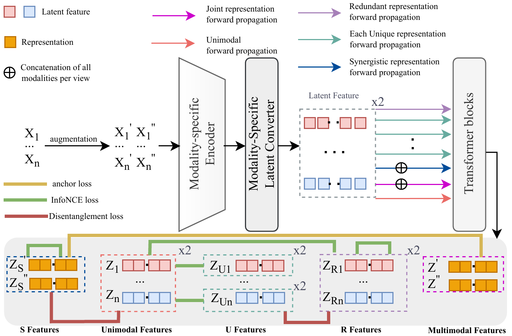

<h1 align="center">
  URSyn: Synergy-Aware Multimodal Disentanglement Learning
</h1>

<p align="center">
  <strong>Junhong Liu, Liangjian Wen, Jiang Duan, Yong Dai, Jianzhuang Liu,<br>
  Zhen Tian, Tao Peng, Jun Wang, Zhao Kang</strong>
</p>

<p align="center">
  
  
  <a href="https://pytorch.org/"></a>
</p>

<p align="center">
  Official PyTorch implementation of <strong>URSyn</strong> (<strong>U</strong>nique, <strong>R</strong>edundant, <strong>Syn</strong>ergistic).
</p>

<p align="center">
  <a href="#overview">Overview</a> |
  <a href="#main-results">Main Results</a> |
  <a href="#method">Method</a> |
  <a href="#getting-started">Getting Started</a> |
  <a href="#code-layout">Code Layout</a> |
  <a href="#license">License</a> |
  <a href="#citation">Citation</a>
</p>

---

<a id="overview"></a>

## Overview

<p align="center">
  
  <em>URSyn turns one fused embedding into three separately accessible factors, and supervises each of them with a different access path.</em>
</p>

Partial Information Decomposition (PID) gives natural coordinates for a multimodal representation — redundant, unique and synergistic information — but existing self-supervised disentanglement stops at a shared/private split, and interaction-oriented methods capture synergy only *inside* one fused embedding. URSyn learns a factor for **all three** types, so each one can be probed and recombined on its own. Synergy, in this view, is the information that emerges only when the modalities are observed jointly.

- **Three separately accessible factors.** $Z_{U_i}$, $Z_R$ and $Z_S$ are supervised by singleton references, by their mutual consensus, and by the full input respectively.
- **Constraints with a known target.** Idealized access constraints bound the task information of $Z_R$ and $Z_S$ by redundancy- and synergy-related quantities, without ever estimating PID values.
- **Synergy readable from a single factor.** On Trifeature, $Z_S$ alone reaches **83.46%** on the joint-only target, above the complete representations of InfMasking (77.00%) and CoMM (70.41%).
- **Stronger downstream representations as well.** The MultiBench classification average rises from 64.28% (CoMM) to **66.75%**, and V&T end-effector MSE drops from $7.65\times10^{-4}$ to $5.24\times10^{-4}$.

<a id="main-results"></a>

## Main Results

All numbers are means over five runs; linear probing follows the CoMM protocol.

### Controlled Disentanglement · Trifeature

Linear probing accuracy (%). Red.: shared shape; Uniq.: modality-specific texture; Syn.: joint texture–color target (chance 50%).

| Method                  |            Red. |           Uniq. |                    Syn. |
| :---------------------- | --------------: | --------------: | ----------------------: |
| Cross<sup>†</sup>      | **100.0** |            11.6 |                    50.0 |
| Cross+Self<sup>†</sup> |            99.7 |            86.9 |                    50.0 |
| FactorCL<sup>†</sup>   |            99.8 |            62.5 |                    46.5 |
| CoMM                    |   99.93 ± 0.04 |   87.23 ± 2.40 |           70.41 ± 1.90 |
| InfMasking              |   99.90 ± 0.09 | **90.55** |           77.00 ± 4.22 |
| **URSyn (ours)**        |   99.90 ± 0.10 |   87.76 ± 1.81 | **83.56 ± 1.97** |

Single-factor probing shows each target is best predicted by its designated factor (margins of 75.15 / 54.22 / 63.62 / 33.46 points for R / U₁ / U₂ / S).

### Real-World Benchmarks · MultiBench (two modalities)

MSE ($\times10^{-4}$, lower is better) for Vision&Touch end-effector regression, accuracy (%) elsewhere.

| Method                       |              V&T EE ↓ |                MIMIC ↑ |                 MOSI ↑ |             UR-FUNNY ↑ |              MUSTARD ↑ |         Avg. ↑ |
| :--------------------------- | ---------------------: | ----------------------: | ----------------------: | ----------------------: | ----------------------: | --------------: |
| Cross<sup>†</sup>           |          33.09 ± 3.67 |           66.70 ± 0.10 |           47.80 ± 1.80 |           50.10 ± 1.90 |           53.50 ± 2.90 |           54.52 |
| Cross+Self<sup>†</sup>      |           7.56 ± 0.31 |           65.49 ± 0.00 |           49.00 ± 1.10 |           59.90 ± 0.90 |           53.90 ± 4.00 |           57.07 |
| FactorCL<sup>†</sup>        |          10.82 ± 0.56 |           67.30 ± 0.00 |           51.20 ± 1.60 |           60.50 ± 0.80 |           55.80 ± 0.90 |           58.70 |
| DisentangledSSL<sup>◇</sup> |                     – |                   66.44 |                   65.16 |                   64.24 |                   61.60 |           64.36 |
| CoMM                         |           7.65 ± 1.83 |           66.47 ± 0.40 |           64.46 ± 3.05 |           62.82 ± 1.10 |           63.35 ± 6.49 |           64.28 |
| **URSyn (ours)**             | **5.24 ± 1.26** | **68.00 ± 0.20** | **67.06 ± 1.20** | **64.93 ± 0.62** | **66.99 ± 2.48** | **66.75** |

### Three Modalities · MultiBench

| Method                 | #Mod. |               V&T CP ↑ |             UR-FUNNY ↑ |
| :--------------------- | :---: | ----------------------: | ----------------------: |
| Cross                  |   2   |           85.82 ± 0.31 |      50.10<sup>†</sup> |
| Cross+Self             |   2   |           86.74 ± 0.55 |      59.90<sup>†</sup> |
| CoMM                   |   2   |           86.14 ± 1.28 |           62.82 ± 1.10 |
| **URSyn (ours)**       |   2   | **88.76 ± 0.74** | **64.93 ± 0.62** |
| CMC<sup>†</sup>        |   3   |                   94.10 |                   59.20 |
| CoMM                   |   3   |           94.10 ± 0.10 |           64.76 ± 1.35 |
| **URSyn (ours)**       |   3   |           94.10 ± 0.05 | **65.58 ± 0.88** |

### Vision + Language · MM-IMDb

Weighted / macro F1 (%). <sup>△</sup>: extra unlabeled pretraining on MM-IMDb.

| Method                         |             weighted-F1 |                macro-F1 |
| :----------------------------- | ----------------------: | ----------------------: |
| SimCLR<sup>†△</sup> (V only)   |           40.35 ± 0.23 |           27.99 ± 0.33 |
| CLIP<sup>†</sup>               |                   58.90 |                   50.90 |
| SLIP<sup>†△</sup>              |           56.54 ± 0.19 |           47.35 ± 0.27 |
| CLIP<sup>†△</sup>              |           54.49 ± 0.19 |           44.94 ± 0.30 |
| CoMM (CLIP)                    |           60.72 ± 0.37 |           53.48 ± 0.38 |
| **URSyn (CLIP)**               | **62.62 ± 0.67** | **55.76 ± 0.67** |

<sup>†</sup> rows are taken from the respective papers and may differ in backbone and training setup; CoMM and URSyn share backbone and protocol.

<a id="method"></a>

## Method

### Pretraining pipeline

1. **Build access references.** Two label-preserving views are encoded by modality-specific encoders. Shared Transformer blocks are evaluated on each singleton input and on the concatenated all-modality input, giving singleton references $Z_1,\dots,Z_M$ and full references $Z',Z''$.
2. **Couple unique and redundant factors.** $Z_{U_i}$ preserves the singleton-accessible information of modality $i$; every $Z_{R_j}$ must be predictable from *every* singleton reference and must agree with the other redundant factors. An entropy term plus a cosine hinge push $Z_{U_i}$ away from the redundant family without collapsing it.
3. **Repel the synergy factor from singletons.** $Z_S$ is computed from the joint input and aligned with the opposite full view, while its alignment with every singleton reference is penalized — so synergy is *concentrated* in one factor instead of being mixed into a fused embedding.
4. **Route the frozen factors downstream.** After pretraining, Relative-Diversity Routing weights $Z_{U_1},\dots,Z_{U_M},Z_R,Z_S$ by how dissimilar each factor is from the others; it is applied only at evaluation time and never affects representation learning.

### Objective

$$
L_{\text{URSyn}} = L_U + \lambda_R L_R + \lambda_{UR} L_{UR} + \lambda_S L_S + \lambda_{S\perp} L_{S\perp}
$$

The weighting coefficients live under `model.model.loss_kwargs` in [`configs/model/ursyn.yaml`](configs/model/ursyn.yaml) (`entropy_weight`, `align_weight`, `lambda_repel`, `epsilon`, `lambda_R`, `lambda_UR_dis`, `lambda_S`, `lambda_S_dis`) and can be overridden on the command line.

<a id="getting-started"></a>

## Getting Started

### Installation

```
git clone https://github.com/liujunhong2/URSyn.git
cd URSyn
conda env create -f environment.yml
conda activate ursyn
```

Dataset paths are configured in [`dataset/catalog.json`](dataset/catalog.json).

### Training

| Experiment | Command |
| :--- | :--- |
| Trifeature (controlled synthetic) | `bash run_scripts/trifeatures_run.sh` |
| MultiBench, two modalities (MIMIC, MOSI, UR-FUNNY, MUSTARD, V&T contact prediction) | `bash run_scripts/multibench_run.sh` |
| MultiBench, three modalities | `bash run_scripts/tri-mod_run.sh` |
| MultiBench, V&T end-effector regression | `bash run_scripts/visionandtouch_reg_run.sh` |
| Multimodal IMDb (vision + language) | `bash run_scripts/MM_IMDb_run.sh` |

Each script trains five seeds and writes to `<root>/URSyn/<dataset>/<exp_name>`. Overriding a single setting works as usual with Hydra, for example:

```
python main_multibench.py data.data_module.dataset=mosi model.model.loss_kwargs.lambda_repel=10
```

### Evaluation

Edit [`run_scripts/test.sh`](run_scripts/test.sh) to match the training run (entry point, dataset settings, checkpoint), then:

```
bash run_scripts/test.sh
```

<a id="code-layout"></a>

## Code Layout

| Path | Contents |
| :--- | :--- |
| `configs/` | Hydra configs: datasets, model, per-experiment training settings |
| `dataset/` | Dataset wrappers and Lightning data modules |
| `evaluation/` | Linear-probing and ridge-regression callbacks |
| `losses/` | The URSyn objective |
| `models/` | Encoders, input adapters, fusion transformer |
| `pl_modules/` | Lightning modules (`URSyn` and its base class) |
| `run_scripts/` | Launch scripts, one per experiment group |
| `assets/` | Figures used in this README |

<a id="license"></a>

## License

Released under the [Apache License 2.0](LICENSE). You are free to use, modify and redistribute the code, including for commercial purposes, provided that the copyright and license notices are retained.

<a id="citation"></a>

## Citation

The paper is currently under review. The BibTeX entry will be added here once it is published.

<a id="acknowledgments"></a>

## Acknowledgements

This codebase builds upon [CoMM](https://github.com/Duplums/CoMM), whose backbone, linear-probing protocol and MultiBench encoders we reuse. We thank the authors for their excellent implementation.
